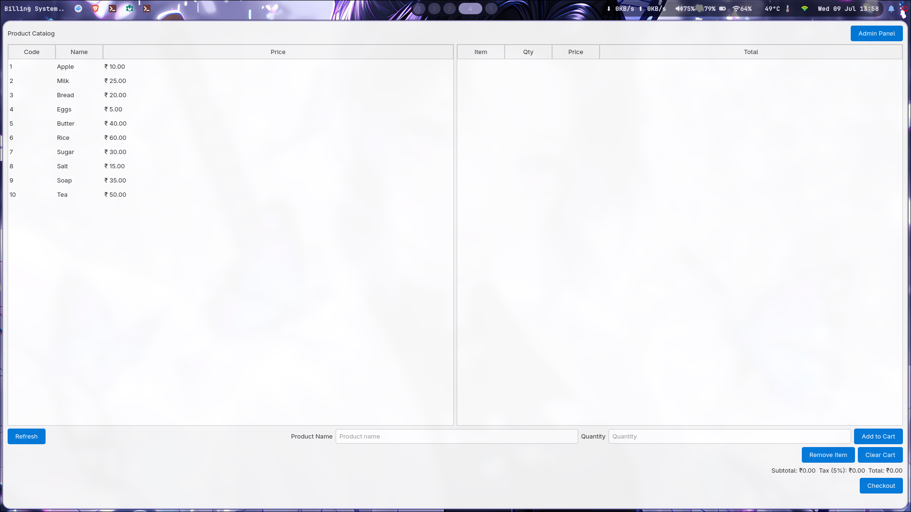

# Billing System

A simple and efficient billing system designed for small to medium-sized businesses. Built with C++ and the Qt framework, it provides a user-friendly interface for managing products and processing sales.



## Tech Stack

*   **C++17:** The core application logic is written in modern C++.
*   **Qt Framework (6 or 5):** For the graphical user interface (GUI).
    *   **Modules:** QtWidgets, QtGui, QtCore, QtSql.
*   **SQLite:** For the database to store products, sales, and admin information.
*   **QSS (Qt Style Sheets):** For custom styling of the application.

## Features

### Product & Stock Management
*   **Add, Update, and Delete Products:** Easily manage your product catalog.
*   **Automatic Stock Control:** Stock levels are automatically decremented after each sale.
*   **Stock Overview:** View all product stock levels from the admin panel.

### Billing & Sales
*   **Streamlined Cart:** A simple process to add products to a shopping cart.
*   **Autocomplete Search:** Quickly find products by name with a search-as-you-type feature.
*   **Automatic Bill Generation:** Calculate totals (including tax) and generate a bill on checkout.
*   **Cart Management:** Easily remove individual items or clear the entire cart.

### Administration
*   **Secure Admin Panel:** Access to administrative functions is protected by a robust login system.
*   **Admin User Management:** Create and delete administrator accounts directly from the admin panel.
*   **Full Database Reset:** A powerful option to clear all transactional and product data for a fresh start.

## Getting Started

### Prerequisites

*   A C++ compiler (like GCC or Clang).
*   **Qt 6** or **Qt 5** (including the `QtWidgets`, `QtSql` modules).
*   **SQLite 3** library.

### Building and Running

1.  **Clone the repository:**
    ```bash
    git clone https://github.com/Nivedck/Billing-System.git
    cd Billing-System
    ```

2.  **Using Qt Creator (Recommended):**
    *   Open the `Billing-System.pro` file in Qt Creator.
    *   Configure the project with your Qt kit.
    *   Build and run the project.

3.  **Using the Command Line:**
    ```bash
    qmake
    make
    ./Billing-System
    ```

## How to Use

### Admin Panel

1.  Click the "Admin Panel" button on the main window.
2.  **Login:** Enter your admin username and password. The default credentials for the first run are `username: admin`, `password: admin`.
3.  Once logged in, you can:
    *   **Manage Products:** Add, update, or delete products.
    *   **Manage Admins:** Add or delete other admin users.
    *   **Clear Database:** Reset all application data.

### Billing

1.  **Add to Cart:**
    *   Start typing a product name and use the autocomplete suggestions.
    *   Enter the quantity and click "Add to Cart".
2.  **Manage Cart:**
    *   Select items in the cart to remove them individually.
    *   Click "Clear Cart" to empty it.
3.  **Checkout:**
    *   Click "Checkout" to finalize the sale and generate a bill.

## Contributing

Contributions are welcome! If you have any ideas, suggestions, or bug reports, please open an issue or create a pull request.

## License

This project is licensed under the MIT License - see the [LICENSE](LICENSE) file for details.
